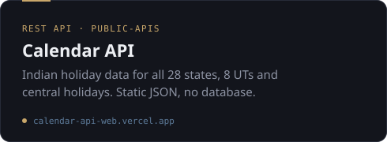
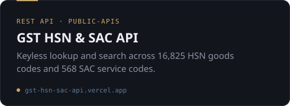
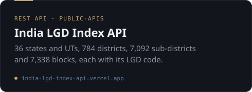
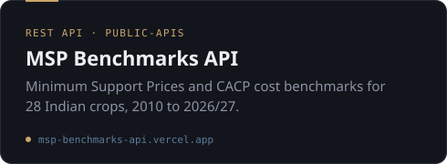
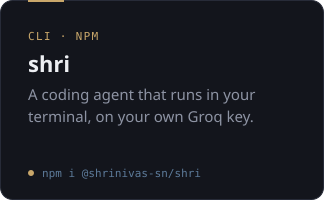
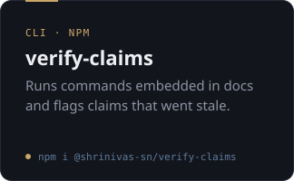
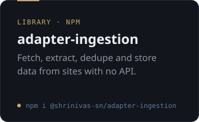

## Activity

## Stack

BUILD 

DATA &amp; CLOUD 

   

## Open data APIs

Five free, keyless APIs on Indian government data. All five are listed in [public-apis](https://github.com/public-apis/public-apis).

## Developer tools

## Things I built for myself

| App | What it does |
|---|---|
| [**Gearwright**](https://shrinivas-sn.github.io/gearwright/) | A third-person mechanical puzzle game in three.js |
| [**Model Bench**](https://model-bench.shrinu.workers.dev/) | Compare AI models on published benchmark scores |
| [**Promptly**](https://my-promptly-app.lovable.app/) | Turns a rough idea into a structured PRD for AI builders |
| [**Budget Buddy**](https://budget-buddy-seven-jet.vercel.app) | Tracks my expenses and investments |
| [**To-do**](https://shrinu-to-do.vercel.app) | My daily task app |
| [**Smart Local Finder**](https://smart-local-guide.vercel.app) | Discover places near you |
